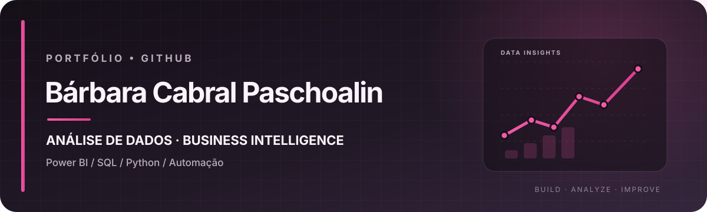

  

  
  
  

---

## Sobre mim

Sou formada em **Análise e Desenvolvimento de Sistemas** e direciono minha carreira para **Análise de Dados e Business Intelligence**.

Tenho 8 anos de experiência em ambiente industrial, com vivência nos processos administrativos, comerciais e operacionais e no uso de sistemas ERP. Essa experiência me ajuda a conectar a análise técnica à realidade do negócio: entender o processo, organizar os dados e transformá-los em informações úteis para a tomada de decisão.

Atualmente, desenvolvo projetos com Power BI, SQL e Python, incluindo dashboards, análise de indicadores e automação de rotinas.

## Stack e ferramentas

  
  
  
  
  
  
  
  
  
  

## Projetos em destaque

| Projeto | O que você encontra |
|---|---|
| [ERP Industrial Analytics](https://1959414-5.github.io/meu-portfolio/projeto-erp-industrial-analytics.html) | Projeto de análise de dados aplicado a um cenário industrial, com MySQL, SQL, modelagem e consultas analíticas. |
| [Automação de Relatórios](https://1959414-5.github.io/meu-portfolio/projeto-automacao-relatorios.html) | Automação em Python para reduzir tarefas manuais na rotina de relatórios e apoiar a integração com ERP e Google Sheets. |
| [Portfólio completo](https://1959414-5.github.io/meu-portfolio/) | Estudos de caso, dashboards, soluções e detalhes dos projetos desenvolvidos. |

## Como gosto de trabalhar

- **Visão de negócio:** compreender o processo antes de definir indicadores.
- **Qualidade dos dados:** organizar, tratar e validar as informações.
- **Análise:** transformar dados em métricas e insights claros.
- **Automação:** reduzir tarefas repetitivas e tornar rotinas mais eficientes.

## Vamos nos conectar?

Estou aberta a oportunidades na área de **Análise de Dados / BI**.

  
  
  

---

  Construindo soluções com dados, tecnologia e visão de negócio.

