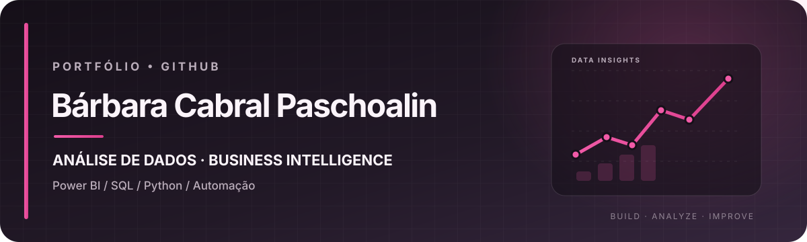

  

  
  
  

---

## Sobre mim

Sou formada em **Análise e Desenvolvimento de Sistemas** e construo projetos que conectam **dados, desenvolvimento de software e automação**.

Tenho experiência em ambiente industrial desde 2018, com atuação em processos administrativos, comerciais e operacionais e uso de ERP. Essa vivência orienta a forma como desenvolvo soluções: entender o processo, estruturar a informação e transformar necessidades reais em aplicações, análises e automações.

Atualmente, meus projetos abrangem dashboards e indicadores com Power BI, consultas e modelagem SQL, aplicações web full stack, integração com bancos de dados e serviços externos, além de automações com Python.

## Stack e ferramentas

  
  
  
  
  
  
  
  
  
  
  

## Projetos em destaque

### Desenvolvimento de software e produtos

| Projeto | Descrição | Acesso |
|---|---|---|
| **Bloomio · Plataforma SaaS** | Sistema de gestão para salões, barbearias e clínicas de estética. Reúne agenda, clientes, serviços, estoque, financeiro, comissões, relatórios, portal público de agendamento e integrações. | [Produto](https://bloomio.com.br/) · [Estudo de caso](https://1959414-5.github.io/meu-portfolio/projeto-bloomio.html) |
| **Aprova · Plataforma de estudos** | Plataforma educacional com trilhas, aulas, diagnóstico, simulados, flashcards, redação, acompanhamento de progresso e recursos de tutoria com IA. | [Demonstração](https://1959414-5.github.io/Aprova/) · [Código-fonte](https://github.com/1959414-5/Aprova) · [Estudo de caso](https://1959414-5.github.io/meu-portfolio/projeto-aprova.html) |
| **ERP Industrial Analytics 3D** | Aplicação full stack com planta industrial navegável em 3D, painéis de produção, estoque e comercial, API e assistente de IA conectado a consultas analíticas. | [Demonstração](https://1959414-5.github.io/erp-industrial-3d/) · [Repositório](https://github.com/1959414-5/erp-industrial-3d) |
| **ERP Industrial Analytics (SQL)** | Modelagem relacional e consultas analíticas para cenários comerciais, estoque e produção, com dados fictícios e foco em indicadores operacionais. | [Estudo de caso](https://1959414-5.github.io/meu-portfolio/projeto-erp-industrial-analytics.html) · [Repositório](https://github.com/1959414-5/erp-industrial-analytics) |

### Dados e automação

| Projeto | Descrição | Acesso |
|---|---|---|
| **Automação de Relatórios com Python** | Projeto demonstrativo de automação desktop, calendário de dias úteis, conferência de parâmetros e controles para execução de rotinas de ERP. | [Estudo de caso](https://1959414-5.github.io/meu-portfolio/projeto-automacao-relatorios.html) · [Código demonstrativo](https://github.com/1959414-5/automacao-relatorios-python) |
| **Portfólio de tecnologia** | Reúne módulos, estudos de caso, imagens dos projetos, tecnologias e demonstrações. | [Acessar portfólio](https://1959414-5.github.io/meu-portfolio/) |

## Como abordo os projetos

- **Contexto antes da solução:** compreender o problema e o fluxo de trabalho antes de escolher a tecnologia.
- **Dados confiáveis:** estruturar, tratar e validar informações para gerar análises consistentes.
- **Arquitetura e segurança:** separar responsabilidades, proteger credenciais e aplicar controles de acesso quando necessário.
- **Experiência de uso:** transformar funcionalidades técnicas em fluxos claros e interfaces úteis.
- **Evolução contínua:** documentar decisões, testar comportamentos e aprimorar as soluções.

## Vamos nos conectar?

Estou aberta a oportunidades nas áreas de **Dados, Business Intelligence e Desenvolvimento de Software**.

  
  
  

---

  Construindo soluções com dados, tecnologia e visão de negócio.

